<!-- The card block below is generated by scripts/profile_cards.py - edit the script, not the HTML. -->
<!--START_SECTION:cards-->

<!--END_SECTION:cards-->

  

## Editors / Tools
<!--START_SECTION:waka-->
<!--END_SECTION:waka-->
